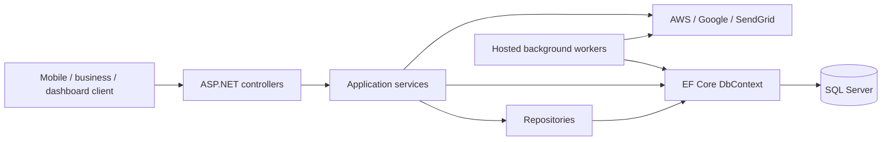

# Saudi Plus backend

Archived ASP.NET Core backend for a discontinued client project, retained as a portfolio
case study and a source-based .NET learning resource. There is no maintained live demo.

The API models a platform connecting individual users and businesses through offers,
branches, offer redemption, invoices, and points/wallet features. It also includes
administration, permission management, support tickets, and Arabic/English responses.
This repository contains the backend; client applications are not included.

## Start reviewing here

- [Architecture and request walkthroughs](docs/architecture.md)
- [.NET concepts, code examples, and learning exercises](docs/dotnet-study-guide.md)
- [Interview preparation and resume guidance](docs/interview-guide.md)
- [Secret configuration and publication notes](SECURITY.md)

## Technology used

| Area | Implementation in this repository |
| --- | --- |
| API | C#, ASP.NET Core 8, controllers, dependency injection |
| Data | SQL Server, Entity Framework Core 9, migrations, LINQ |
| Accounts | ASP.NET Core Identity, JWT bearer authentication, refresh tokens |
| Authorization | Permission claims and a custom authorization attribute |
| Integrations | AWS S3/CloudFront, SNS/SQS, Firebase initialization, SendGrid, Google APIs |
| API documentation | Swagger documents for Mobile, Business, and Dashboard audiences |
| Other | AutoMapper, Arabic/English localization, QR-code generation |
| Delivery | Multi-stage Dockerfile, Compose, historical GitHub Actions deployment example |

These are implementation references, not claims of production guarantees. For example,
queue processing needs reliability improvements and some errors use a JSON statusCode
without setting the corresponding HTTP status. Those tradeoffs are covered in the guides.

## Architecture



This is a layered monolith in one main application project. Services also use DbContext
directly; the structure does not enforce strict Clean Architecture boundaries.

## Explore or build locally

Reading the code and the learning guides requires no credentials or running cloud services.
To compile the main API with a suitable .NET SDK:

```sh
dotnet restore SaudiPlus/SaudiPlus.csproj
dotnet build SaudiPlus/SaudiPlus.csproj --no-restore
```

The main API targets .NET 8. The separate `AwsSnsNotificationServer` folder contains a
weather-forecast scaffold and is not part of the main solution; its name does not mean it
implements the notification backend. The actual workers are in `SaudiPlus/Service/`.

To run the API, install the matching ASP.NET Core runtime, configure your own SQL Server
and integrations using [SECURITY.md](SECURITY.md), then run:

```sh
dotnet run --project SaudiPlus -- --environment Development
```

Startup applies database migrations and seeds configured administrator accounts. Use a
throwaway local database. The application is not currently configured for an offline demo;
background workers and feature flows can contact external services. No original client
credentials are required or included in the public source.

Swagger is enabled outside Production. Check the launch profile or startup output for
the selected URL, then open `/swagger`.

## Project map

| Path | Purpose |
| --- | --- |
| `SaudiPlus/Program.cs` | Composition root, configuration, authentication, middleware, startup |
| `SaudiPlus/Controllers/` | HTTP endpoints and request binding |
| `SaudiPlus/Service/` | Feature workflows and integration adapters |
| `SaudiPlus/Repository/` | EF Core data queries and persistence helpers |
| `SaudiPlus/Interfaces/` | Service/repository contracts and shared entity abstractions |
| `SaudiPlus/Entities/` | Domain data and Identity/EF Core model |
| `SaudiPlus/Request/`, `SaudiPlus/Response/` | API contracts |
| `SaudiPlus/Configurations/` | DI, authorization, localization, Swagger configuration |
| `SaudiPlus/AutoMapper/`, `SaudiPlus/Migrations/` | Mapping profiles and schema evolution |
| `SaudiPlus/EmailTemplates/`, `SaudiPlus/Resources/` | Email templates and localized resources |

## Status and limitations

The project is archived and has no automated test project in this checkout. The main API
build and publish were verified during sanitization; database, cloud, and Docker execution
were not verified. NuGet reported dependency advisories documented in SECURITY.md.
The historical deployment workflow is manual-only, so portfolio pushes do not deploy.

The source is useful for studying existing application decisions, including decisions that
would be improved today. The learning guide separates implemented behavior from suggested
exercises. It does not claim CQRS, microservices, comprehensive test coverage, or measured
performance results that the repository does not demonstrate.

## Preparing a public portfolio copy

Keep the original repository private. Use `python tools/export_portfolio.py` to create a
reviewable `.portfolio-export/` directory with sanitized working files and no Git history.
Review that output and scan it before initializing a new public repository. See
[SECURITY.md](SECURITY.md) for credential and history considerations.
