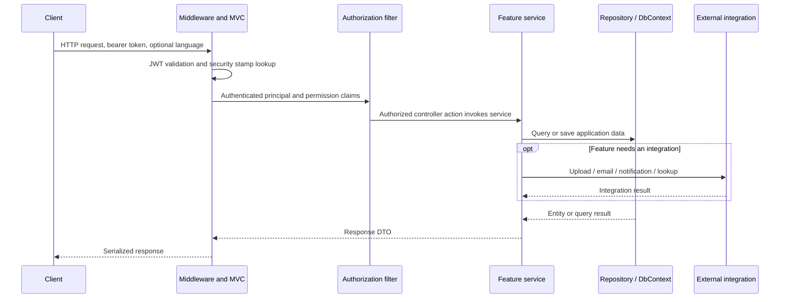

# Architecture and code walkthroughs

This describes the current source, not the client's infrastructure or a live service.
For individual concepts and exercises, see the [study guide](dotnet-study-guide.md).

## Application boundary

[Program.cs](../SaudiPlus/Program.cs) composes the main ASP.NET Core application.
Controllers, feature services, repositories, data entities, and integration adapters
are compiled together in [SaudiPlus.csproj](../SaudiPlus/SaudiPlus.csproj).
This is a layered monolith. Folder organization provides separation of responsibilities,
but services can access DbContext and cloud SDKs directly, so dependency boundaries
are conventions rather than separate assemblies enforced by the compiler.

The [solution](../saudi_plus_backend.sln) includes the API and Compose project.
The separate AwsSnsNotificationServer folder is a scaffold, not the worker host used
by the main application. Both actual hosted workers are registered in Program.cs.

## Request pipeline

Not every endpoint requires authentication or an integration. Middleware order is
visible in Program.cs: forwarded headers, custom language middleware, rate limiter,
CORS, request localization, authentication, authorization, and mapped controllers.
The named rate limiter applies only where selected, for example a Policy endpoint;
registering it does not automatically impose a global ten-request limit.

## Walkthrough 1: create an offer

1. [OfferController](../SaudiPlus/Controllers/Offer/OfferController.cs) binds a multipart
   form to CreateOfferDTO and requires the Offer.Create permission. The business path
   resolves the current business; the admin path supplies a business ID.
2. [CreateOfferDTO](../SaudiPlus/Request/Offer/CreateOfferDTO.cs) defines the request
   contract and field constraints. Service validation handles offer-type combinations,
   redemption-code rules, and the maximum logo count.
3. [OfferService.CreateOffer](../SaudiPlus/Service/Offer/OfferService.cs) obtains an EF
   execution strategy and begins a database transaction inside its delegate.
4. AutoMapper creates an Offer entity, which is inserted through OfferRepository.
   [FileService](../SaudiPlus/Service/FileService.cs) uploads logos to S3. OfferLogo
   records reference the returned URLs, then the service saves and commits the data.
5. The service maps a response DTO; MVC serializes it using the configured Newtonsoft
   settings. A statusCode field in the DTO does not by itself set the HTTP status.

**Design discussion:** the SQL transaction cannot roll back S3 uploads. A retry can repeat
external work, and holding a database transaction during a network upload increases
lock duration. An improvement would stage uploads, use deterministic/idempotent object
keys, and add compensating cleanup or an outbox-style workflow as appropriate. Those
improvements are proposals, not existing guarantees.

## Walkthrough 2: authentication and permission checks

[IdentityConfiguration](../SaudiPlus/Configurations/IdentityConfiguration.cs) registers
Identity with custom User/Role entities and EF stores. Account and auth services use
UserManager rather than implementing password hashing themselves.

[TokenService](../SaudiPlus/Service/TokenService.cs) creates an HMAC-signed JWT containing
identity, security stamp, and permission claims. Permissions come from role defaults
and user-specific records. Program.cs validates the signature, issuer, audience,
and lifetime, then fetches the user to compare the current security stamp.

[AuthPermissionAttribute](../SaudiPlus/Configurations/PermissionAuthorizeAttribute.cs)
requires authentication and **any one** of the listed permissions. An empty permission
list only requires authentication. It returns 401 for an unauthenticated principal
and 403 for an authenticated principal without the requested permission.

This permission check does not automatically prove resource ownership. The feature
workflow must also ensure the caller can access the selected business, offer, or user.
Permission claims are a snapshot at token issuance; changing permission records needs
a deliberate token refresh/invalidation strategy to take effect immediately.

Refresh-token handling accepts both the current and previous stored token. That is
an application-specific tolerance mechanism with replay/concurrency implications,
not proof of secure single-use rotation. There are multiple token storage paths in
the code; a redesign should unify storage, expiry, hashing, and revocation behavior.

## Walkthrough 3: queued notifications

[NotificationService](../SaudiPlus/Service/NotificationService.cs) can enqueue a message
in SQS or send a message to a device endpoint using SNS.
[SqsNotificationProcessor](../SaudiPlus/Service/SqsNotificationProcessor.cs) long-polls
SQS, deserializes payloads, creates a DI scope, finds active users, resolves device
endpoints, and publishes notifications. Firebase is separately initialized in
Staging/Production; do not assume every notification path uses Firebase directly.

The current worker deletes a received message **before completing delivery** and also
deletes on an inner error. That can lose messages after a failure. The producer's
payload envelope and the worker's NotificationPayload contract also need an integration
test. Parallel endpoint lookups share scoped repositories, which can result in concurrent
access to the same DbContext; EF contexts should not be used concurrently.

An improved design would define one message contract, acknowledge after successful
processing, handle cancellation deliberately, bound parallelism, isolate database scopes,
and configure retry/dead-letter behavior. Queue delivery and external publishes should
be treated as potentially repeated operations and made idempotent where needed.

## Persistence and cross-cutting behavior

[SaudiPlusDbContext](../SaudiPlus/Entities/SaudiPlusDbContext.cs) inherits
IdentityDbContext and configures entity relationships, unique indexes, delete behavior,
and a notification discriminator. It updates audit timestamps through ChangeTracker
in SaveChanges overrides. Several repositories and services filter soft-delete flags
explicitly; there is no demonstrated blanket guarantee that every query hides deleted rows.

[ApplicationConfiguration](../SaudiPlus/Configurations/ApplicationConfiguration.cs)
registers service/repository interfaces as scoped. A web request normally shares a scope;
a BackgroundService needs to create its own scopes for scoped work. Cloud adapters read
options or IConfiguration, while JWT settings and database connections are set at startup.

[LanguageConfiguration](../SaudiPlus/Configurations/LanguageConfiguration.cs) selects
Arabic or English from Accept-Language, while LanguageMiddleware sets the application's
language service. Exact supported header values are used; this is not a full parser for
all language preference lists and quality weights.

## Delivery and archival status

The Dockerfile restores/builds/publishes with an SDK image and runs with an ASP.NET
runtime image. Compose provides SQL Server and a read-only local secret mount.
The historical GitHub Actions workflow is manual-only after archival preparation.
The project has no separate automated test project in this checkout and no offline
integration simulator. See [SECURITY.md](../SECURITY.md) for build evidence and limitations.
